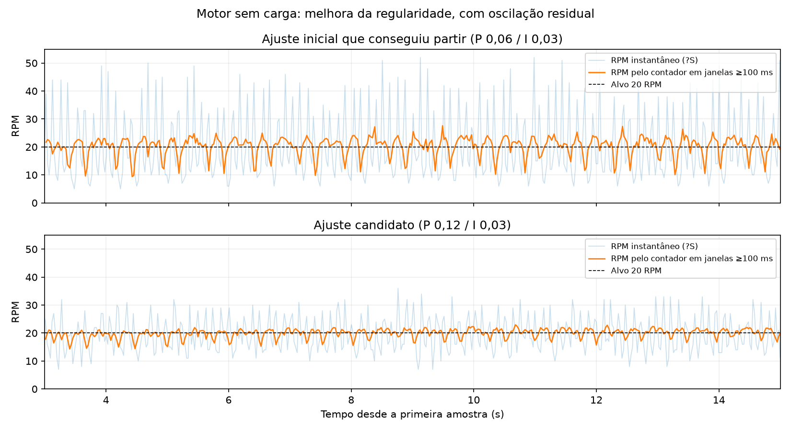

# Sintonia de 20 RPM — 07/10/2026

## Resultado

Motor 1, Roboteq SBLG2360T v3.0f (15/07/2026), Kalatec KTC-86BLS98-J/X046, encoder AS5047P A/B de 1000 PPR (4000 contagens/volta). Bancada sem carga, sentido positivo. Meta experimental: [20 RPM no eixo do motor](BAIXA-VELOCIDADE.md).

A configuração inicial não conseguiu sustentar a partida a 20 RPM: o supervisor encerrou por ausência de progresso do sensor interno. A sintonia final partiu e sustentou dois ensaios a 20 RPM, incluindo repetição após o ensaio a 3000 RPM. O operador considerou aceitável o giro observado na bancada. Existe oscilação residual; isso não significa velocidade perfeitamente uniforme nem validação do conjunto sob carga.

## Parâmetros finais na RAM

| Parâmetro | Valor anterior | Valor final | Registro bruto final |
|---|---:|---:|---|
| Kp velocidade | 0,03 | 0,12 | `KPG 1 = 120000` |
| Ki velocidade | 0,01 | 0,03 | `KIG 1 = 30000` |
| Kd velocidade | 0 | 0 | `KDG 1 = 0` |
| Filtro de velocidade | 45 Hz | 80 Hz | `LPFB 1 = 80` |
| Sensor de comutação | Hall | Hall + encoder | `BFBK 1 = 2` |
| Kp FOC, fluxo e torque do Motor 1 | 0,1 | 0,2 | `KPF 1 = KPF 3 = 2000` |
| Ki FOC, fluxo e torque do Motor 1 | 25,1328 | 50,2656 | `KIF 1 = KIF 3 = 502656` |
| Aceleração | 3000 RPM/s | 3000 RPM/s | `MAC 1 = 30000` |
| Desaceleração normal | 200 RPM/s | **2000 RPM/s** | `MDEC 1 = 20000` |

Índices 1 e 3 de KPF/KIF correspondem a fluxo e torque do **Motor 1**, não a motores 1 e 3. Mantidos: MMOD1 (malha de velocidade), encoder externo como feedback, EPPR1000, quatro pares de polos, limite de corrente 11,5 A, velocidade máxima 3000 RPM, watchdog 1000 ms, proteção de erro 500 RPM/500 ms e tabela Hall calibrada. Motor 2 preservado nos valores comparáveis lidos.

A desaceleração foi solicitada pelo usuário e confirmada por leitura `~MDEC 1 = 20000`; a escala do catálogo é 10, portanto **2000 RPM/s**. A rampa real de parada normal não foi cronometrada nesta rodada. Os ensaios supervisionados terminam em `!EX`; isso não mede a rampa normal de comando zero, nem altera a semântica do botão Parar.

Os ganhos de corrente foram ajustados empiricamente. A indutância continua desconhecida; RS/LD/LQ não foram inventados ou alterados. **Nenhuma gravação EEPROM foi feita nesta rodada.**

## Evidência medida

Médias pelo deslocamento do contador do encoder, após os primeiros três segundos; 4000 contagens/volta. Leituras instantâneas são a consulta `?S` na mesma região.

| Alvo | Média pelo contador | Mín.–máx. instantâneo | Resultado |
|---|---:|---:|---|
| 20 RPM, ensaio final de 20 s | 20,06 RPM | 7–36 RPM | Sem falhas; aceito pelo operador |
| 100 RPM | 99,55 RPM | 77–126 RPM | Sem falhas |
| 500 RPM | 499,47 RPM | 485–511 RPM | Sem falhas |
| 1500 RPM | 1499,16 RPM | 1482–1514 RPM | Sem falhas |
| 3000 RPM | 2995,36 RPM | 2977–3028 RPM | Sem LoopErr; AmpLim intermitente |
| 20 RPM, repetição de 15 s | 19,88 RPM | 6–35 RPM | Sem falhas |

No primeiro ensaio final a 20 RPM, a velocidade pelo contador em janelas de pelo menos 100 ms variou entre 14,32 e 23,51 RPM, com desvio padrão de 1,56 RPM. No ajuste anterior que já conseguia partir (Kp0,06/Ki0,03), o desvio era aproximadamente 3,45 RPM: redução de cerca de 55% nessa métrica. Essa comparação descreve os ensaios, não uma garantia de desempenho em qualquer carga/posição do rotor.

A 3000 RPM, 95% do alvo foi observado em aproximadamente 1,03 s, pico de 3028 RPM e erro máximo amostrado de 161 RPM. PWM chegou a 99,9%; há pouca margem de tensão no topo. AmpLim foi sinalizado em parte das amostras mesmo sem excesso de corrente capturado; a aquisição serial não mede todos os picos internos.

## Comparações rejeitadas e limites

- Kp0,02/Ki0,05 agravou os avanços e pausas; configuração descartada.
- Kp0,2 provocou forte oscilação, e o supervisor interrompeu por leitura de sentido contrário. Não permaneceu aplicado.
- Filtros de 20, 45, 80 e 120 Hz foram comparados em diferentes etapas. Aumentar a filtragem, isoladamente, não resolveu a irregularidade.
- Com os mesmos ganhos recentes, comutação apenas por Hall não melhorou o resultado frente a Hall + encoder.
- As consultas são sequenciais, aproximadamente 38–40 ciclos/s, e não simultâneas. As janelas do contador usam o timestamp de fim de ciclo; atraso/jitter de transporte limita especialmente as estimativas de curta duração em alta rotação. Não interpretar extremos dessas janelas como precisão metrológica. Média correta não comprova ausência de pequenas pausas; a observação do operador complementa os dados.
- Não foi isolada uma causa única para a oscilação residual (controle, atrito/cogging ou erro angular do encoder). Não houve caracterização da indutância, medição independente de torque, validação térmica prolongada, reversão, transmissão mecânica ou carga real nesta rodada.

## Verificação e arquivos

Nova leitura do catálogo ao final, perfil exportado e comparação com o início: nove registros alterados, todos listados acima. `~MLX 2` foi rejeitado pelo firmware; o perfil exportado permanece marcado como parcial (636 campos conhecidos de 638). As conclusões de preservação se referem aos valores conhecidos e comparáveis.

Estado final: `?S = 0:0`, `?BS 1 = 0`, `?FF = 16`, `?FM 1 = 128`; motor parado por EX, permissões manuais de movimento/escrita desligadas. FF16/FETs Off nesse estado decorrem da parada deliberada do ensaio.

- [Parâmetros verificados](ensaios/2026-10-07-20rpm/parametros-verificados.json)
- [Diferenças brutas início/fim](ensaios/2026-10-07-20rpm/diferencas-finais.json)
- [Comparativo de todos os ensaios](ensaios/2026-10-07-20rpm/comparacao.csv)

Capturas completas JSON/CSV, perfis inicial/final e respostas de verificação no diretório local irmão `../sintonia-20rpm-2026-10-07/`. Os perfis são registros para recuperação e comparação; sua importação completa não substitui revisão antes de aplicar a outro equipamento.

Base técnica: Roboteq Advanced Digital Motor Controllers User Manual v3.0c, seções de Hall + Encoder e registros BFBK (p.431), HSAT (p.439), EMOD (p.398) e LPFB (p.405). Usada a cópia local previamente obtida em `work/reference/controllers-v3.0c.pdf`. Não houve alteração do código/binário do aplicativo nesta rodada.
